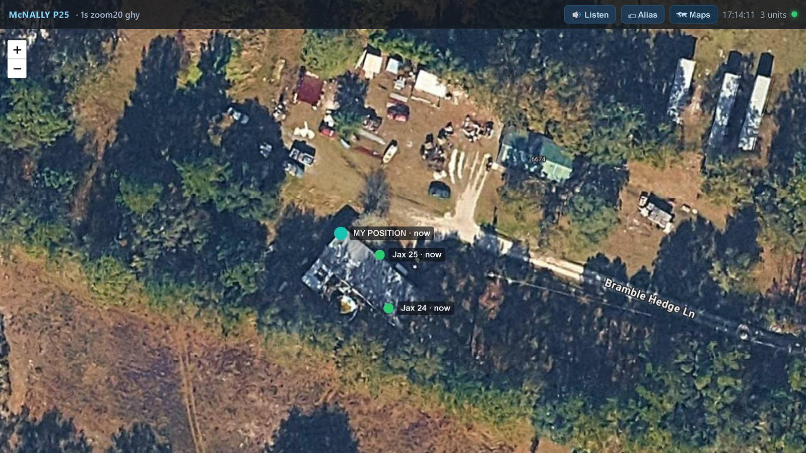

# Claude McNally's PC P25 Receiver and GPS Map Plotter

**Hear your P25 fleet and see where every unit is — off the air, on a plain PC. Free, offline, receive-only.**

### 🌐 **[See the public project page →](https://jim-dc95811.github.io/PC-P25-Receiver-and-GPS-Map-Plotter/)**

🤖 **Setting this up with an AI's help?** Point your assistant at **[Build it with your AI — the full path from zero](SETUP_WITH_YOUR_AI.md)**. It's written for your AI to walk you through the whole build — radio tap, install, maps, going live — even if you've never touched GitHub or Python. *(Working on the code itself? See [CLAUDE.md](CLAUDE.md).)*

Every P25 radio already transmits its own position in a standardized, open format, and its voice right alongside it. This receiver pulls **both straight out of the air** — nothing but a radio, a USB sound card, and this program — and puts the whole fleet on **your own offline map**: every unit by its radio ID, your own position beside them, and, the moment someone keys up, **who is talking with their voice playing right in the browser**.

No SDR. No base station. No internet, no cell, no cloud. No special dongle, no patent-encumbered part. One folder, one double-click.

- **⬇️ Download (Google Drive):** [Claude McNally P25 Receiver v2.0](https://drive.google.com/drive/folders/1YksApYLX_a8ZOlpwrNfGQcnOdYGCMxyj) — the ready-to-run folder (loose files, no browser security warning). *(The zip is also in this repo if you prefer: [`Claude_McNally_P25_Receiver_v2.0.zip`](Claude_McNally_P25_Receiver_v2.0.zip).)*
- **📖 User guide:** [`Claude McNally P25 Receiver v2.0/Claude McNally P25 Receiver User Guide.pdf`](Claude%20McNally%20P25%20Receiver%20v2.0/Claude%20McNally%20P25%20Receiver%20User%20Guide.pdf)

*Live, off the air — and you can hear it: the current speaker named and lit while your own position and the fleet ride your own Z20 imagery.*

---

## What you plug in

- **USB sound card → the radio's detector / discriminator audio** — the flat *detected* audio (e.g. a Kenwood NX-700 **DEO pin 19**, radio set **WIDE**), not the speaker/voice audio. This single feed carries **both** the GPS positions and the voice. A Sound Blaster Play! 3 is proven.
- **USB GPS → the PC** for your own "you are here" dot. A Garmin GPS 18 USB is proven. Optional — the fleet still plots without it.
- **Your offline maps** — `.tpkx` or `.mbtiles` for your area (see below), picked from anywhere on the PC.

The radio is only ever **received** — this receiver never transmits or alters a radio.

## Running it

A Windows PC with **Python 3** (tick *Add python.exe to PATH* when you install it). Double-click the one `.bat`; the first run installs three small helpers and then runs fully offline. A live map opens in your browser — every unit by its ID, live/stale colors, your own position, a **▶ Listen** button for the voice, and **CURRENT SPEAKER** lighting the talking unit on the map. Full steps are in the user guide.

---

## Your offline maps — make them yourself, free

This receiver shows the fleet on **your own offline imagery**, so there's nothing to subscribe to and nothing that phones home. You build those maps once, for your area, with a free, open companion toolset:

**→ [ArcGIS Earth Unlocked](https://github.com/Jim-dc95811/ArcGIS-Earth-Unlocked)** ([project site](https://jim-dc95811.github.io/ArcGIS-Earth-Unlocked/)) — a free family of map-making tools:
- **MBTiles → TPKX converter** and the **Master 4 grid planner** — turn offline map tiles into the `.tpkx` packages this receiver reads.
- **Picture World Maker**, **Point/Parcel** tools, and more — build and enrich your own offline maps with no GIS background required.

Drop the finished `.tpkx` or `.mbtiles` anywhere on your PC and point the receiver at it. (ArcGIS Earth Unlocked is a separate project you can use for any offline mapping; this receiver just reads the maps it makes.)

---

## How it works (one breath)

An FM radio already demodulates the RF to a flat four-level baseband at its detector output — the hard radio work is done. This receiver takes that off a sound card and decodes the standardized P25 **Tier-1 location data** in software: symbol recovery, framing, and error correction, down to the position and the transmitting radio's individual ID. The same frames carry **voice**, decoded by a pure-software IMBE vocoder (no dongle, no SDR), with the transmitting radio's link-control ID naming the current speaker. Location and voice are fused by that shared ID, so the unit you hear is the dot that lights up.

## Technical specifications

**📐 [P25 OTA Decode — Master Technical Reference (PDF)](https://drive.google.com/file/d/1ti8PrJOqAL_1Uf1vo2SAfIl8FFc20zIT/view)** — the complete engineering reference behind the receiver. Every stage of the over-the-air GPS and voice decode, specified down to the exact constants, tables, and bit-layouts: symbol recovery, framing, error correction, the pure-software IMBE vocoder, current-speaker fusion, and sensitivity. Written for a DSP/protocol engineer — or another AI — rebuilding this from scratch. *(Opens in Google Drive; a copy also lives in this repo: [P25_OTA_Decode_Master_Reference.pdf](P25_OTA_Decode_Master_Reference.pdf).)*

## Status

- **Proven live:** Tier-1 GPS decode off the air; the offline map plotter; your own position; and **voice decode** with the **current speaker** identified and lit on the map — all on a normal PC, nothing installed on the viewer.
- Voice is quality-gated so marginal signals never play as garbage, and the whole key-up is reconstructed and played clean, start to finish.
- Hardened for the field: a bad burst can't stall the decoder, a yanked sound card recovers on its own, and memory stays flat over long runs.

---

*Claude McNally's PC P25 Receiver and GPS Map Plotter — an original, built by Claude McNally. Radio → live map and live voice, offline, read-only.*
